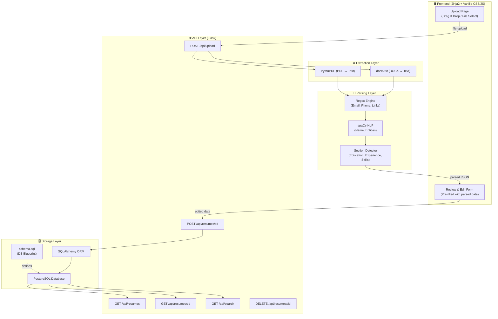
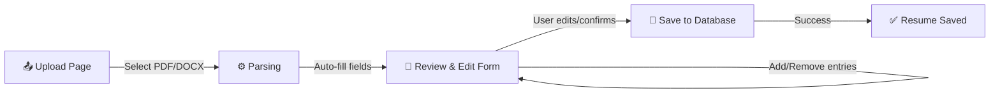
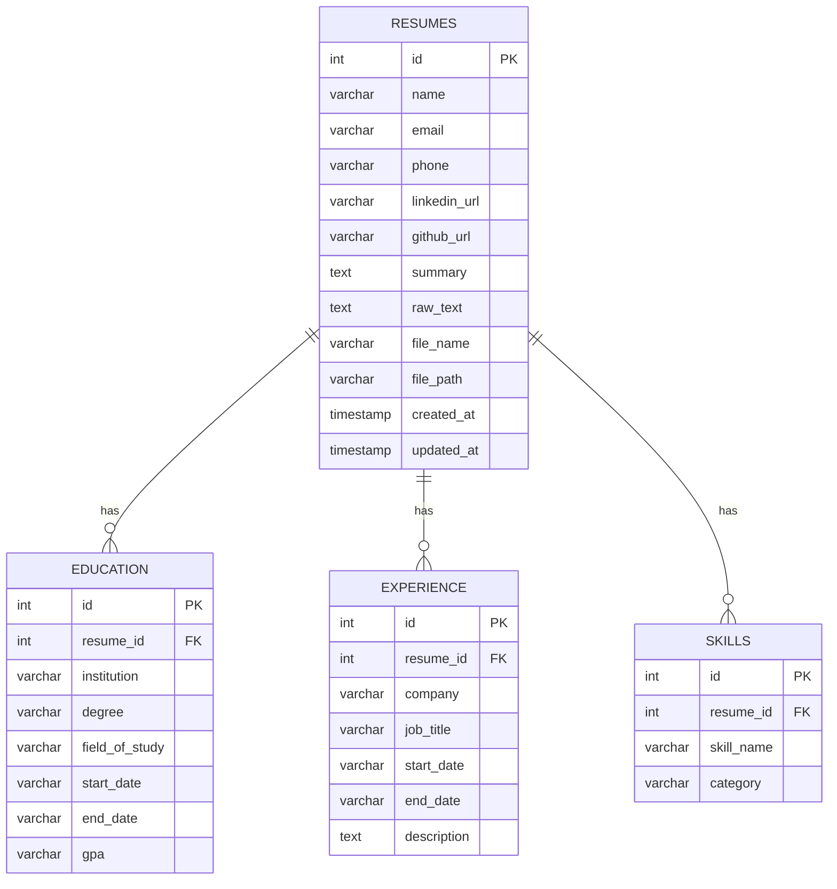
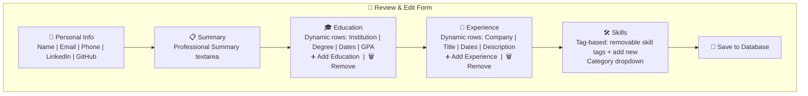
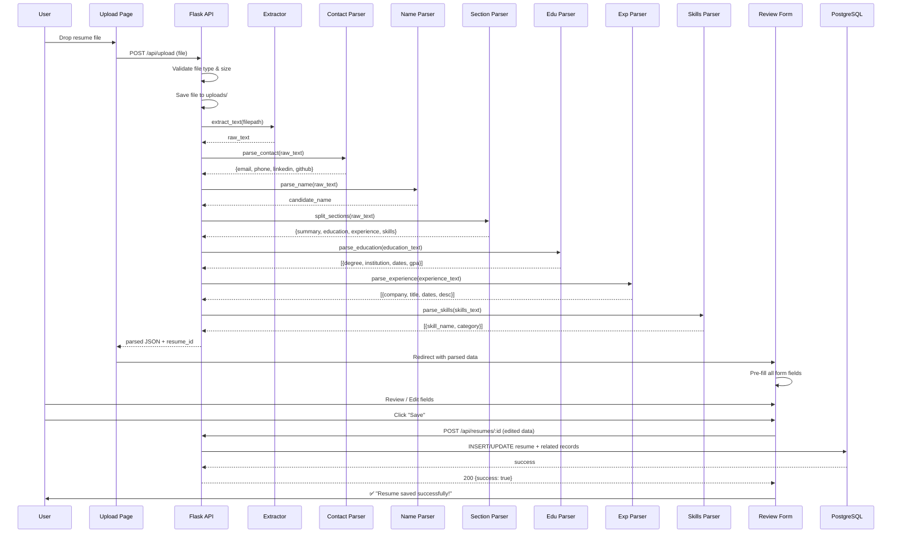

# 📄 Resume Parser — Phase-Wise Implementation Plan (v3)

> A Python-based resume parser that extracts structured information from PDF/DOCX resumes, displays parsed data in an editable form, and stores it in a PostgreSQL database.

---

## 1. Architecture Overview



---

## 2. User Flow



> **The flow:** User uploads a resume → system parses it → extracted data is displayed in an editable form → user reviews, corrects, or adds missing fields → clicks Save → data is stored in PostgreSQL.

---

## 3. Tech Stack

| Layer | Technology | Purpose |
|:---|:---|:---|
| **Frontend** | `Jinja2` templates + Vanilla CSS + Vanilla JS | Upload page & review/edit form |
| **Text Extraction** | `PyMuPDF` (fitz) | Extract text from PDFs |
| **Text Extraction** | `docx2txt` | Extract text from DOCX files |
| **NLP** | `spaCy` (en_core_web_sm) | Named Entity Recognition (name extraction) |
| **Pattern Matching** | `re` (stdlib) | Regex for emails, phones, URLs, dates |
| **Database** | `PostgreSQL` | Persistent structured storage |
| **Schema Management** | `schema.sql` | Standalone SQL file — single source of truth for DB |
| **ORM** | `SQLAlchemy` | Database models, queries |
| **API** | `Flask` | REST API + page serving |
| **Config** | `python-dotenv` | Environment variable management |

---

## 4. Project Structure

```
resume-parser/
├── database/
│   ├── schema.sql                  # ✅ Full DB schema (tables, indexes, constraints, triggers)
│   └── seed_skills.sql             # ✅ Pre-populated skills reference data
├── app/
│   ├── __init__.py                 # Flask app factory
│   ├── config.py                   # Configuration (DB URI, upload path, etc.)
│   ├── models/
│   │   ├── __init__.py
│   │   └── resume.py               # SQLAlchemy models
│   ├── parser/
│   │   ├── __init__.py
│   │   ├── extractor.py            # PDF/DOCX → raw text
│   │   ├── contact_parser.py       # Regex-based: email, phone, LinkedIn, GitHub
│   │   ├── section_parser.py       # Detect & split resume sections
│   │   ├── name_parser.py          # spaCy-based name extraction
│   │   ├── education_parser.py     # Parse education details
│   │   ├── experience_parser.py    # Parse work experience
│   │   ├── skills_parser.py        # Extract skills (keyword + NLP)
│   │   └── resume_parser.py        # Orchestrator — ties all parsers together
│   ├── routes/
│   │   ├── __init__.py
│   │   └── resume_routes.py        # API + page-serving endpoints
│   ├── templates/                   # ✅ Jinja2 HTML templates
│   │   ├── base.html               # Base layout (nav, head, footer)
│   │   ├── upload.html             # Upload page (drag & drop)
│   │   └── form.html               # Review & edit form (pre-filled fields)
│   ├── static/                      # ✅ Frontend assets
│   │   ├── css/
│   │   │   └── style.css           # All styles (dark theme, glassmorphism, animations)
│   │   └── js/
│   │       ├── upload.js           # Drag-and-drop logic, file upload via fetch
│   │       └── form.js             # Dynamic add/remove education/experience, form submit
│   └── utils/
│       ├── __init__.py
│       └── helpers.py              # File validation, text cleaning utilities
├── uploads/                        # Uploaded resume files (gitignored)
├── requirements.txt
├── .env
├── .gitignore
├── run.py                          # Application entry point
└── README.md
```

---

## 5. Database Schema (ER Diagram)



### `database/schema.sql` — Contents

| Section | Contents |
|:---|:---|
| **Header** | Database creation, extension setup, comments |
| **Tables** | `resumes`, `education`, `experience`, `skills` with full column definitions |
| **Constraints** | Primary keys, foreign keys with `ON DELETE CASCADE`, `NOT NULL` rules |
| **Indexes** | Indexes on `email`, `resume_id` FKs, and `skill_name` for search performance |
| **Triggers** | Auto-update `updated_at` timestamp on row modification |
| **Comments** | Inline documentation explaining each table's purpose |

> [!NOTE]
> `schema.sql` can be run independently via `psql -U username -d resume_parser_db -f database/schema.sql` to set up the database without running the Python app.

---

## 6. Frontend — Page Designs

### Page 1: Upload Page (`upload.html`)

| Element | Details |
|:---|:---|
| **Drag & Drop Zone** | Large drop area with dashed border, icon, and "Drop your resume here" text |
| **File Select Button** | "Browse Files" button as fallback |
| **Accepted Formats** | Shows "PDF, DOCX — Max 16MB" |
| **Upload Progress** | Animated progress bar during file upload |
| **Redirect** | On successful parse → redirects to the Review Form page |

### Page 2: Review & Edit Form (`form.html`)

The form is **pre-filled** with all parsed data. User can edit any field before saving.

| Section | Fields | Features |
|:---|:---|:---|
| **Personal Info** | Name, Email, Phone, LinkedIn URL, GitHub URL | Text inputs, pre-filled |
| **Summary** | Professional summary / objective | Textarea, pre-filled |
| **Education** | Institution, Degree, Field of Study, Start Date, End Date, GPA | **Dynamic**: Add / Remove entries with ➕ / 🗑️ buttons |
| **Experience** | Company, Job Title, Start Date, End Date, Description | **Dynamic**: Add / Remove entries with ➕ / 🗑️ buttons |
| **Skills** | Skill Name, Category | **Tag-based**: Each skill shown as a removable tag, plus input to add new ones |
| **Actions** | Save button, Back to Upload link | Save → `POST /api/resumes/<id>` → success toast |

### Form Flow Diagram



---

## 7. Parsing Pipeline (Sequence Diagram)



---

## 8. Prerequisites

Before starting implementation, ensure:

- [ ] **Python 3.10+** installed
- [ ] **PostgreSQL** installed and running
- [ ] **psql** CLI available (for running `schema.sql`)

---

---

# 🚀 Phase-Wise Execution Plan

> [!IMPORTANT]
> Each phase is a self-contained checkpoint. After each phase, we verify everything works before moving to the next. You approve → I build → we validate → next phase.

---

## Phase 1 — Foundation & Database Setup

**Goal:** Project scaffold, dependencies, database schema, SQLAlchemy models, Flask app boots and creates tables.

### Files Created

| # | File | Purpose |
|:---:|:---|:---|
| 1 | `requirements.txt` | All Python dependencies |
| 2 | `.env` | Database URL, secret key, config values |
| 3 | `.gitignore` | Ignore uploads/, .env, __pycache__, etc. |
| 4 | `database/schema.sql` | **Full SQL schema** — tables, indexes, triggers, constraints |
| 5 | `database/seed_skills.sql` | Pre-populated skills list (languages, frameworks, tools) |
| 6 | `app/__init__.py` | Flask app factory with SQLAlchemy initialization |
| 7 | `app/config.py` | Configuration class reading from `.env` |
| 8 | `app/models/__init__.py` | Models package init |
| 9 | `app/models/resume.py` | SQLAlchemy models: `Resume`, `Education`, `Experience`, `Skill` |
| 10 | `run.py` | Entry point — creates app, creates tables |

### Validation
```
✅ pip install -r requirements.txt           → all deps install cleanly
✅ psql -f database/schema.sql               → tables created in PostgreSQL
✅ python run.py                             → Flask app starts, SQLAlchemy connects
✅ Check pgAdmin / psql: 4 tables exist      → resumes, education, experience, skills
```

### Deliverable
> Flask app boots, connects to PostgreSQL, all 4 tables created. `schema.sql` works independently.

---

## Phase 2 — Text Extraction

**Goal:** Given a PDF or DOCX file path, extract clean raw text.

### Files Created

| # | File | Purpose |
|:---:|:---|:---|
| 1 | `app/parser/__init__.py` | Parser package init |
| 2 | `app/parser/extractor.py` | `extract_text(filepath)` — PDF via PyMuPDF, DOCX via docx2txt |
| 3 | `app/utils/__init__.py` | Utils package init |
| 4 | `app/utils/helpers.py` | `clean_text()`, `is_allowed_file()`, text normalization |

### Validation
```
✅ extract_text("sample.pdf")   → readable text output
✅ extract_text("sample.docx")  → readable text output
✅ extract_text("sample.txt")   → raises ValueError
```

### Deliverable
> Can extract and clean text from any PDF/DOCX resume file.

---

## Phase 3 — Parsing Engine

**Goal:** Parse raw resume text into structured fields — name, contact info, education, experience, skills.

### Files Created

| # | File | Purpose |
|:---:|:---|:---|
| 1 | `app/parser/contact_parser.py` | Regex: email, phone, LinkedIn, GitHub |
| 2 | `app/parser/name_parser.py` | spaCy NER name extraction |
| 3 | `app/parser/section_parser.py` | Split resume into sections |
| 4 | `app/parser/education_parser.py` | Parse degree, institution, dates, GPA |
| 5 | `app/parser/experience_parser.py` | Parse company, title, dates, description |
| 6 | `app/parser/skills_parser.py` | Keyword + NLP skill extraction |
| 7 | `app/parser/resume_parser.py` | **Orchestrator** — unified dict output |

### Validation
```
✅ parse_contact("Email: john@email.com Phone: +1-234-567-8900")
   → {"email": "john@email.com", "phone": "+1-234-567-8900"}

✅ parse_resume("sample_resume.pdf")
   → complete structured JSON with all fields
```

### Deliverable
> `parse_resume()` returns a complete structured dictionary from any resume file.

---

## Phase 4 — API Routes & Database Integration

**Goal:** REST API endpoints that accept uploads, parse resumes, store in DB, and support CRUD + search.

### Files Created

| # | File | Purpose |
|:---:|:---|:---|
| 1 | `app/routes/__init__.py` | Routes package init |
| 2 | `app/routes/resume_routes.py` | All API endpoints |

### API Endpoints

| Method | Endpoint | Description |
|:---:|:---|:---|
| `POST` | `/api/upload` | Upload & parse a resume → returns parsed JSON |
| `POST` | `/api/resumes/<id>` | **Save edited form data** to database |
| `GET` | `/api/resumes` | List all resumes (paginated) |
| `GET` | `/api/resumes/<id>` | Get full resume details |
| `GET` | `/api/search` | Search by skills, name, etc. |
| `DELETE` | `/api/resumes/<id>` | Delete a resume |

### Validation
```
✅ curl -X POST -F "file=@resume.pdf" http://localhost:5000/api/upload
   → 201 with parsed JSON

✅ curl -X POST -H "Content-Type: application/json" -d '{"name":"John",...}' http://localhost:5000/api/resumes/1
   → 200 with saved data

✅ curl http://localhost:5000/api/resumes
   → 200 with paginated list
```

### Deliverable
> Fully functional REST API. Upload → parse → save edited data → retrieve/search/delete.

---

## Phase 5 — Frontend (Upload Page + Review Form)

**Goal:** Two-page frontend — upload page with drag-and-drop, and a review/edit form pre-filled with parsed data.

### Files Created

| # | File | Purpose |
|:---:|:---|:---|
| 1 | `app/templates/base.html` | Base layout — head, nav, footer, font imports |
| 2 | `app/templates/upload.html` | Upload page — drag & drop zone, file select, progress bar |
| 3 | `app/templates/form.html` | Review/edit form — all fields pre-filled, dynamic add/remove |
| 4 | `app/static/css/style.css` | Complete stylesheet — dark theme, glassmorphism, animations |
| 5 | `app/static/js/upload.js` | Drag-and-drop handling, file upload via `fetch`, redirect |
| 6 | `app/static/js/form.js` | Dynamic rows (education/experience), skill tags, form submit |

### Upload Page Features
- Drag & drop zone with animated border
- "Browse Files" fallback button
- Shows accepted formats (PDF, DOCX) and max size
- Animated upload progress bar
- On success → auto-redirects to form page

### Review Form Features
- **Personal Info**: Name, Email, Phone, LinkedIn, GitHub (text inputs)
- **Summary**: Professional summary (textarea)
- **Education**: Dynamic entries — ➕ Add / 🗑️ Remove rows
- **Experience**: Dynamic entries — ➕ Add / 🗑️ Remove rows
- **Skills**: Tag-based input — removable skill tags + add new skill
- **Save Button**: Sends edited data to `POST /api/resumes/<id>` → success toast

### Validation
```
✅ Open http://localhost:5000             → Upload page renders with drag-drop zone
✅ Drag a PDF onto the zone              → Progress bar, then redirect to form
✅ Form shows pre-filled parsed data     → Name, email, education, etc. populated
✅ Click ➕ Add Education                 → New empty row appears
✅ Click 🗑️ on an experience entry       → Row removed
✅ Add a new skill tag                   → Tag appears, removable
✅ Click Save                            → Data saved to DB, success toast shown
```

### Deliverable
> Complete two-page frontend. Upload → auto-parse → review/edit in form → save. Beautiful dark-themed UI with smooth animations.

---

## Phase 6 — Error Handling, Logging & Polish

**Goal:** Production-grade error handling, structured logging, input validation, and end-to-end testing.

### Changes Made

| # | File | Changes |
|:---:|:---|:---|
| 1 | `app/__init__.py` | Global error handlers (400, 404, 413, 500) |
| 2 | `app/utils/helpers.py` | File size validation, MIME type checking |
| 3 | All parser files | try/except blocks, graceful fallbacks |
| 4 | `app/routes/resume_routes.py` | Input validation, proper HTTP status codes |
| 5 | `app/templates/form.html` | Error/success toast notifications |
| 6 | `run.py` | Structured logging configuration |

### Error Handling Matrix

| Scenario | HTTP Code | Response |
|:---|:---:|:---|
| No file in request | `400` | `{"error": "No file provided"}` |
| Invalid file type | `400` | `{"error": "File type not allowed. Use PDF or DOCX"}` |
| File too large (>16MB) | `413` | `{"error": "File too large. Max 16MB"}` |
| Resume not found | `404` | `{"error": "Resume not found"}` |
| Parse failure (partial) | `200` | Returns parsed data with `null` for unparsable fields |
| Database error | `500` | `{"error": "Internal server error"}` |

### Validation
```
✅ Upload a .txt file                    → Error toast "File type not allowed"
✅ Upload a 20MB file                    → Error toast "File too large"
✅ Upload a weirdly-formatted resume     → Form shows with partial data (no crash)
✅ Check terminal logs                   → Structured output with timestamps
```

### Deliverable
> Battle-tested application. Graceful errors on both frontend and API. Structured logs. Ready for real-world usage.

---

## Summary — Phase Checklist

| Phase | Description | Files | Status |
|:---:|:---|:---:|:---:|
| **Phase 1** | Foundation & Database Setup | 10 files | ⬜ Pending |
| **Phase 2** | Text Extraction | 4 files | ⬜ Pending |
| **Phase 3** | Parsing Engine | 7 files | ⬜ Pending |
| **Phase 4** | API Routes & DB Integration | 2 files | ⬜ Pending |
| **Phase 5** | Frontend (Upload + Review Form) | 6 files | ⬜ Pending |
| **Phase 6** | Error Handling & Polish | 6 files modified | ⬜ Pending |

---

> [!TIP]
> **Ready to start?** Approve this plan and I'll begin with **Phase 1** — creating the project scaffold, `schema.sql`, database models, and getting Flask connected to PostgreSQL.
